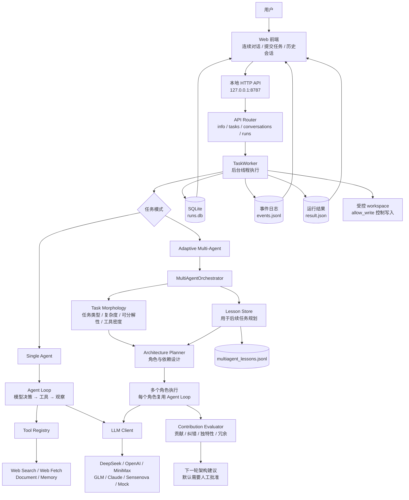

# Metamorph

一个本地运行、可联网检索并具备跨会话记忆的**通用智能体**（General-purpose Agent）。
架构参考 scilink-agent 的分层设计，但业务逻辑保持通用，不绑定任何垂直领域。

## 架构

Metamorph 当前是一个本地 API-first Agent 系统：浏览器只调用本地后端，模型 API Key 始终留在后端进程中。任务可以选择单 Agent 或基于任务形态自动设计的多 Agent 流程。



### 一次任务的执行路径

```text
用户输入任务
  → POST /v1/tasks
  → TaskWorker 创建 run 和 conversation
  → 选择 Single Agent 或 Adaptive Multi-Agent
  → 调用模型、工具和受控 workspace
  → 写入 SQLite、事件日志和运行结果
  → 前端轮询状态并展示最终回答
  → 多 Agent 按 DAG 依赖层执行，额外记录贡献评估、消融结果、Lesson 和下一轮架构建议
```

当前的架构建议只保存为 candidate，不会自动改写代码、权限或工具。贡献评估目前是可解释的代理指标；后续应通过移除角色、合并角色和屏蔽消息等受控干预，测量真实的因果边际贡献。

每次运行还会记录任务成功率、token 使用量、延迟、工具调用次数，以及移除单个 Agent 后的性能变化。未接入 benchmark/task scorer 时，`task_success_rate` 保持未知；非空输出只能作为执行状态，不能替代任务正确率，也不会用于 causal replay 或 ablation 的性能比较。

### 代码分层

| 包 / 模块 | 职责 |
|-----------|------|
| `llm/` | 模型接入层：各 provider 默认配置 + OpenAI 兼容 client 构造 |
| `graphs/` | 智能体核心：agent→tools 循环 + 思考链提取（对应 scilink `graphs/`） |
| `prompts/` | 通用系统提示（对应 scilink `prompts/`） |
| `tools/` | 工具集（对应 scilink `tools/`） |
| ├─ `base.py` | 注册表 + pydantic→OpenAI schema 转换 + dispatch |
| ├─ `web.py` | `web_search` / `web_fetch` |
| ├─ `document.py` | `read_document` |
| └─ `memory.py` | `update_user_memory`（本地 JSONL 跨会话记忆） |
| `state/` | 运行状态：`events.py` 事件日志 + `store.py` SQLite 运行记录（history 持久化） |
| `api/` | HTTP 接口层：路由、worker 和 `frontend/` 前端 |
| `config/` | 应用配置（`settings.py` 定义 `Settings`） |
| `multiagent/` | 任务形态、角色架构、lesson、贡献评估和调整建议 |
| `main.py` | 命令行入口（`serve` / `run`） |

## 快速开始

```bash
pip install -e ".[openai,tools]"      # 核心 + 可选工具依赖

# 设置凭证（仅当前终端会话，不落盘）
export DEEPSEEK_API_KEY="sk-xxx"       # Windows PowerShell: $env:DEEPSEEK_API_KEY="sk-xxx"

# 可选：为本地 API 开启 Bearer token 认证
export METAMORPH_API_TOKEN="change-me"

# 启动本地服务（默认 DeepSeek + 单 Agent）
metamorph serve --port 8787
```

打开 http://127.0.0.1:8787 即可在页面中与 agent 对话，实时看到：
**思考过程（可折叠）+ 工具调用卡片 + 最终回答**。

### 使用 Sensenova 启动（推荐配置）

模型 `sensenova-6.8-flash-lite`，API Key 通过环境变量传入，**不写入文件、不落盘**。

```powershell
# Windows PowerShell
$env:METAMORPH_ALLOW_WRITE="1"          # 开启后 agent 才能使用 write_file 等可变工具
$env:SENSENOVA_API_KEY="sk-xxx"          # 替换为你的真实 key，仅当前终端会话有效
python main.py serve --host 127.0.0.1 --port 8787 --provider sensenova --model sensenova-6.8-flash-lite
```

```bash
# macOS / Linux
export METAMORPH_ALLOW_WRITE=1
export SENSENOVA_API_KEY="sk-xxx"
python main.py serve --host 127.0.0.1 --port 8787 --provider sensenova --model sensenova-6.8-flash-lite
```

启动后访问 http://127.0.0.1:8787 。常用可选环境变量：

- `METAMORPH_MAX_STEPS`：单任务最大执行轮次（默认 50）。
- `METAMORPH_API_TOKEN`：为本地 API 开启 Bearer token 认证。

> 重启前如遇端口占用，用 `Get-NetTCPConnection -LocalPort 8787` 查残留进程并结束，再重新启动。

### 命令行直接运行

```bash
metamorph run "帮我查一下今天上海的天气"
```

## 支持的模型供应商

`openai` / `deepseek` / `minimax` / `glm` / `claude` / `sensenova`
（默认 `deepseek`，模型 `deepseek-v4-pro`）。

切换供应商无需改动代码：

```bash
python main.py serve --provider deepseek
python main.py serve --provider openai --mode multiagent
```

配置示例见 `.env.example`。

## 测试

```bash
pytest
```

## 设计原则

1. 架构对齐 scilink-agent 的分层，但业务逻辑通用，无垂直领域硬编码。
2. 模型接入与 agent 逻辑解耦：新增 provider 只需在 `llm/providers.py` 的 `PROVIDER_DEFAULTS` 登记。
3. 工具即插即用：在 `tools/` 下用 `register()` 声明，自动进入 schema 与 UI。
4. 所有运行证据（事件、结果）落盘可回溯；刷新页面可恢复完整思考链与工具轨迹。
5. 多 Agent 的架构建议只作为 candidate 保存，默认不自动修改代码、权限或工具。
6. 外部 URL 仅允许安全的 HTTP(S) 目标，工具输出、请求体和工作区访问均有大小或路径边界。
