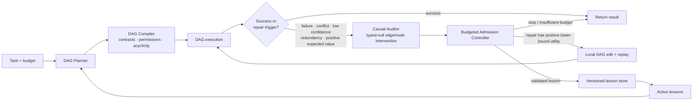

# Research log — 2026-08-31

## Paper direction

**Causally Governed, Budgeted Scaffold Evolution for Multi-Agent Systems**

### One-sentence thesis

Multi-agent systems should evolve reusable collaboration policies by admitting only causally validated, budget-positive DAG edits into long-term memory.

## Problem

Current self-improving agents often modify prompts, memory, tools, or workflows without knowing whether a particular communication or structural change actually caused the improvement. They also spend budget on unproductive repair loops and may preserve poisoned, overfit, or non-transferable experience.

## Core research questions

1. Which Agent-to-Agent communication edges and local DAG structures genuinely improve task utility?
2. When is an additional repair, replay, or causal audit worth its token, latency, tool, and risk budget?
3. Which causally validated collaboration lessons transfer to structurally similar tasks?
4. How can the system prevent critic gaming, memory poisoning, and negative transfer under distribution drift?

## Minimal system loop

## Four mechanisms

### 1. Causal DAG auditing — central contribution

Hold the context, tool outputs, model, and budget fixed; mask one communication edge with a typed null artifact, then replay only the affected downstream subgraph. The measured effect is the utility difference between treatment and intervention, not a lexical similarity proxy.

### 2. Budgeted continuation and self-stop

Each candidate action (repair, replay, audit, or stop) is evaluated by a configurable net-utility interface:

`U = quality − cost − latency − safety risk − regression risk`.

The exact estimator and coefficients remain open research choices. The invariant is that the system continues only when the conservative expected gain is positive and the remaining budget covers the action.

### 3. Causally validated lessons

A lesson is a versioned DAG-policy patch rather than a reflection or raw chat trace. It stores: applicability conditions, base graph and edit, artifact contracts, causal treatment/control evidence, cost and safety scope, transfer history, and a continuously updated strength value.

Lifecycle: `Candidate → Active → Disabled`. Promotion requires controlled evidence; future matched tasks retain a small no-lesson control group. Negative transfer, drift, or safety violations decay or disable the lesson.

### 4. Governance and drift awareness

The Planner proposes, the Auditor intervenes, and the Admission Controller accepts or rejects updates. These roles must not collapse into a self-confirming evaluator. Every long-term write is versioned, permission-scoped, auditable, reversible, and subject to a drift-aware fallback to the baseline DAG.

## Evaluation plan

- **Causal validity:** Does edge-level intervention identify communication that changes downstream quality and net utility?
- **Efficiency:** Does budgeted self-stop preserve task quality while reducing tokens, critical-path latency, tools, and unnecessary replays?
- **Transfer:** Do Active lessons improve held-out tasks with similar structure, including shifted task, tool, or evidence conditions?
- **Safety and stability:** Are regression, unsafe tool actions, memory poisoning, critic exploitation, and negative transfer detected and bounded over time?

## Scope decision

The first paper focuses on **scaffolding evolution**, not foundation-model fine-tuning, global Shapley attribution, or unconstrained full-DAG evolution. The primary contribution is causal auditing of local collaboration structure plus budgeted, governed lesson admission.

## Immediate next step

Implement a minimal vertical slice: typed artifacts and DAG contracts; edge masking and downstream replay; utility/budget logging; Candidate/Active/Disabled lesson persistence; and controlled benchmark runs.
