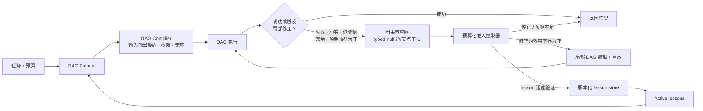

# 研究日志 — 2026-08-31

## 论文方向

**Causally Governed, Budgeted Scaffold Evolution for Multi-Agent Systems**

### 一句话主张

多 Agent 系统应只将经过因果验证、且在预算内产生正净收益的 DAG 编辑，写入长期记忆并复用为协作策略。

## 问题

现有自进化 Agent 往往修改 prompt、memory、tool 或 workflow，却无法证明某条通信或某个结构变化真正造成性能提升；它们也可能在无效修正上耗尽预算，并沉淀受污染、过拟合或无法迁移的经验。

## 核心研究问题

1. 哪些 Agent 间通信边和局部 DAG 结构真正提升任务效用？
2. 何时值得花 token、延迟、工具与风险预算去做修正、重放或因果审查？
3. 哪些经过因果验证的协作 lesson 能迁移到结构相似的任务？
4. 如何在分布漂移下避免 critic 被投机、memory 被污染与 lesson 负迁移？

## 最小系统闭环

## 四个机制

### 1. DAG 因果审查 — 核心贡献

固定上下文、工具结果、模型与预算；用 typed null artifact 屏蔽一条通信边，并只重放受影响的下游子图。衡量的是处理组与干预组的效用差，而不是词汇相似度代理指标。

### 2. 预算化继续与自停

系统将修正、重放、审查或停止视为候选行动，并通过可替换的净效用接口评估：

`U = 质量 − 成本 − 延迟 − 安全风险 − 回归风险`。

具体估计器和系数可以后续迭代；不变原则是：仅当保守预期收益为正，且剩余预算可覆盖行动时，系统才继续。

### 3. 经因果验证的 lessons

lesson 是版本化的 DAG policy patch，不是反思文本或原始聊天记录。它保存：适用条件、基础图与编辑、artifact contract、处理/对照因果证据、成本与安全范围、迁移历史，以及连续更新的强度值。

生命周期：`Candidate → Active → Disabled`。提升为 Active 必须有对照证据；未来匹配任务保留少量不调用 lesson 的对照组。出现负迁移、漂移或安全违规时，lesson 衰减或停用。

### 4. 治理与漂移感知

Planner 负责提议，Auditor 负责干预审查，Admission Controller 决定是否准入，三者不可合并为自我确认的评估器。每个长期写入都必须可版本追踪、权限受限、可审计、可回滚；检测到漂移时回退至基线 DAG。

## 评估计划

- **因果有效性：** 边级干预能否识别真正改变下游质量与净效用的通信？
- **效率：** 预算自停能否在保持任务质量的同时，减少 token、关键路径延迟、工具调用与无效重放？
- **迁移：** Active lessons 能否提升结构相似的 held-out 任务，包括任务、工具或证据条件变化？
- **安全与稳定：** 是否能随时间检测并约束回归、不安全工具动作、memory poisoning、critic exploitation 与负迁移？

## 范围决策

第一篇论文聚焦于 **scaffolding evolution**，暂不做模型参数微调、全局 Shapley 归因或无约束全 DAG 进化。核心贡献是：局部协作结构的因果审查，以及有预算与治理约束的 lesson 准入机制。

## 近期下一步

实现最小纵向切片：typed artifact 与 DAG contract；边屏蔽和下游重放；效用/预算日志；Candidate/Active/Disabled lesson 持久化；以及受控 benchmark 运行。
