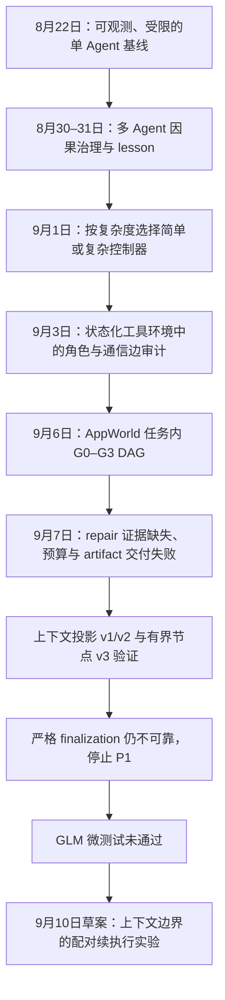

# Metamorph 实验脉络与当前状态

整理日期：2026-09-15。代码基线：`31e568a`；最近一次提交日期为 2026-09-07。本文基于本机现存文档、Git 历史与运行产物，不包含新模型调用或实验重跑。

**当前结论：项目已形成通用 Agent、受控工具执行和可审计 DAG 的工程基础，但尚没有完成可用于检验 DAG 优势、局部因果收益或 held-out profile 迁移的正式实验。AppWorld 停在协议可靠性门槛；最新 LCFM 上下文边界方案仍是待实现草案。**

## 1. 先从这里读

| 要回答的问题 | 入口 |
|---|---|
| 整个研究为什么演变到今天？ | 本文第 2–4 节 |
| 到底运行过什么，有多少证据？ | [自动盘点](experiment_audit/README.md)、[逐次结果索引](experiment_audit/result_index.csv) |
| 原始证据在哪里，是否完整？ | [文件清单与 SHA-256](experiment_audit/file_inventory.csv)、[格式异常](experiment_audit/integrity_issues.csv) |
| AppWorld 为何停止？ | [G3 审计](../../experiments/appworld/GATE1_G3_REPAIR_AUDIT.md)、[v3 停止记录](BOUNDED_NODE_EXECUTION_V3_VALIDATION.md) |
| 下一条候选研究路线？ | [LCFM 草案](LCFM_CONTEXT_BOUNDARY_EXPERIMENT_PLAN.md)，尚未冻结 |

文档状态优先按时间与证据判断：9 月 7 日的停止记录更新了 9 月 6 日的执行清单；9 月 10 日草案提出另一条路线，但不代表旧 DAG Gate 已通过。历史记录中的“下一步”“今晚运行”“一周投稿”均是当时安排，不是当前执行指令。

## 2. 研究主线的演变

| 阶段 | 当时想验证什么 | 实际形成的证据 | 状态与转向原因 |
|---|---|---|---|
| 8/22 单 Agent 基线 | 本机能否安全执行并记录任务 | mock/供应商适配、JSONL、SQLite、API；日志记载 3 项基础测试 | 建立可测量底座，未证明自进化 |
| 8/25 分层重构 | 工程能否持续维护 | `api/graphs/llm/state/tools/memory` 分层；当时记录 7 项测试 | 主要是工程整理，不是 benchmark 效果 |
| 8/30 多 Agent | 任务形态能否驱动角色与依赖执行 | 编排、贡献代理、lesson、前端；当时 13 项测试 | 贡献代理不能替代因果证据 |
| 8/31 因果治理 | 哪条边/哪种局部编辑真正有净收益 | typed-null、下游重放、预算准入、lesson 生命周期；当时 22 项测试 | 有最小机制实现，缺真实受控实验 |
| 9/1 自适应架构 | 简单任务是否应退化为单 Agent | WorkBench 受控执行、S0–S4 探索、Adaptive/Oracle 接入；τ² smoke | 复杂链路增加成本与失败点，改为研究条件性收益 |
| 9/2–3 工程与论文收敛 | 保证任务状态真实，并缩小论文范围 | 取消/轮询/轮次耗尽修复；E1/E2 配置与论文大纲 | lesson 迁移延后；AppWorld 成为后续实验环境 |
| 9/3–6 旧 AppWorld 控制器 | 固定 S3 的组件和边是否有用 | E1/E2 pilot、fixed-S3 P0 多轮调试 | 网络、预算、checkpoint/freezer 清理等干扰；旧路线退出主实验 |
| 9/6 任务内 DAG | 收益来自 inspect、join、check、repair 还是拓扑？ | G0–G3 runtime、fake-world P0、smoke、12-task dev 冻结 | 固定控制平面，改变任务内图；正式矩阵仍待 Gate |
| 9/7 协议与成本诊断 | 能否完整、低成本地交付节点 artifact？ | G3 审计、finalization 分离、context v1/v2、bounded v3 | G3 repair 未获证；v3 仅 1/4 protocol-valid，停止扩展 |
| 9/7 GLM 兼容性 | 更换 provider 能否满足严格结构交付？ | 4 类各 10 次微测试，Phase 1 未通过 | 只说明当时请求配置下的交付问题 |
| 9/10 LCFM 草案 | 压缩时什么状态必须保留？ | A/B/C/D 对照、样本/预算/停止规则设计 | 未实现、未预注册、没有结果 |

早期测试数引用历史日志，**不是本次重新运行的测试结果**。关键来源：[工程日志目录](../doc/)、[Git 对应的研究计划](CAUSAL_WORKFLOW_RESEARCH_PLAN.md)、[最小实验计划](PUBLISHABLE_MINIMUM_EXPERIMENT_PLAN.md)。

## 3. 各 benchmark 实际走到了哪里

### 3.1 BrowseComp-Plus：检索链路探索

本机有 4 个 smoke 目录，其中 3 个有 `smoke_summary.json`，另一个仅保留过程文件。三份摘要都是同一题的单样本探索；均明确未运行官方 judge。

| 输出根后缀 | completed | 总 tokens | 工具调用 | 检索文档记录数 |
|---|---:|---:|---:|---:|
| `20260901-022104` | 0 | 13,666 | 15 | 0 |
| `20260901-022258` | 0 | 73,785 | 28 | 82 |
| `20260901-025354` | 1 | 51,068 | 8 | 36 |

最后一次使用 100,195 文档的本地 FTS 索引，证明链路能结束，不证明答案正确。后续日志把该方向搁置，主线转向状态化工具环境。来源：[原始 runs](../../benchmarks/browsecomp-plus/runs)。

### 3.2 WorkBench：状态化执行跑通，但矩阵不能直接作为正式比较

7 份初始 smoke 结果中，只有 `20260901-094018` 官方 `correct=true`，且 `side_effect=false`；消耗 27,255 tokens、124.18 秒、9 次工具调用。另有 4 次 `blocked_no_write`、1 次 failed，以及 1 次 completed 但官方不正确。这与 9 月 1 日日志中的受控执行成功相互印证。

矩阵目录保存 **120 份** `result.json`，下表是文件级盘点，包含多轮尝试，不是独立任务成功率：

| 条件 | 结果文件数 | official correct=true | blocked_no_write |
|---|---:|---:|---:|
| S0 | 26 | 11 | 11 |
| S1 | 23 | 4 | 19 |
| S2 | 23 | 6 | 17 |
| S3 | 23 | 5 | 18 |
| S4 | 23 | 5 | 18 |
| Adaptive | 1 | 0 | 1 |
| Oracle | 1 | 0 | 1 |

S1 是固定读→计划→写→验证，S2 加最小充分检索，S3 加只读 shadow，S4 加 lesson context。这里的 S3 与后面的 AppWorld G3 含义不同。不能将 S3 的 shadow 自动等同于新协议的 checkpoint 因果重放。

多数受控路径在交接证据/参数不足时阻断，说明守卫在发挥作用，也说明这些运行尚不能证明复杂架构有净收益。Adaptive/Oracle 仅有单任务尝试，未发现完整四条件实验。后续若要分析，必须先冻结可比 cohort、处理重复任务和版本差异，不能取每题最好一次。来源：[smoke](../../benchmarks/workbench/metamorph_runs)、[matrix](../../benchmarks/workbench/metamorph_matrix_runs)。

### 3.3 τ²-Bench：adapter 和评分口径探索

本机 `data/simulations` 有 9 份 JSON，包括 2 份 adapter 汇总、7 份 simulation 文件；其中 2 份 simulation 列表为空。

- retail、airline、telecom 各一条 smoke 都以 `max_steps` 结束，官方 reward=0。
- 2 条本地/mock 单次 simulation 的 DB/action 检查成功，但 COMMUNICATE 未满足，最终 reward=0。
- `metamorph_adapter_smoke.json` 的 S0–S4 都是 reward=0，评分依据为 DB + COMMUNICATE。
- `metamorph_adapter_smoke_env_assertion.json` 改为 DB + ENV_ASSERTION 后，S0/S3/S4 为 1，S1/S2 为 0。任务标识与评分依据都已变化，不能把它解释为同一协议成功率从 0 提升。

这些产物支持 adapter、状态修改与 isolated same-action replay 的工程诊断；未形成真实 domain 上的正式对照结论。来源：[τ² simulations](../../benchmarks/tau2-bench/data/simulations)。τ³ 下载目录不等于完成了本项目实验，本次未在项目产物入口发现对应结果。

### 3.4 AppWorld 旧 fixed-S3：保留为历史诊断

本机 AppWorld 共 **87 份**单臂结果，跨多个协议版本；完整分组见[自动盘点](experiment_audit/README.md)。以下是新 DAG 之前的关键节点：

- `e1_minimal_*` / `e1_pilot_v2_v4pro`：单题接入与基线尝试。
- `e1_pilot_v2_v4pro_gate2`：4 任务 × S0/Complex-only/Adaptive，共 12 份结果；5 completed、7 APIConnectionError、4 strict success。没有 Oracle 臂，复杂路径部分在总预算边界停止，不能作为完整 E1。
- `e2_pilot_v2_v4pro_2train`：目录名虽含 `2train`，现存结果只有 `b7a9ee9_2` 一题的 5 条件。No-Planner / No-Repair 成功，其余失败；单题、调试协议不足以推断组件有害。
- `p0_baselines_v1`：12 条全部因 provider child 的 APIConnectionError 失败。
- `p0_audit_v6/v7`：基线有任务成功，但干预/负控制出现 freezer 清理相关 IndexError / AttributeError，不能算有效因果 pair。
- `p0_audit_v8`：基线与 passthrough 负控制均记录 strict success，但仍属旧 fixed-S3 诊断，不能替代新 DAG 的 P0/P2。
- `p0_audit_v1–v4` 保留 manifest/过程文件但无单臂 result，不能当作完成运行。

源目录：[AppWorld runs](../../experiments/appworld/runs)。旧 E1/E2 配置仍在仓库是为了追溯，不意味着当前应该继续执行它们。

## 4. AppWorld 新 DAG 主线：卡点如何逐步暴露

### 4.1 实验对象和正式流程

控制平面固定为 planner/compiler → executor → final evaluator。比较的对象是任务内图：G0=`act`；G1=`inspect→act→check`；G2=`inspect_a∥inspect_b→join→act→check`；G3 在 check=`NOT_VERIFIED` 后执行 repair→final_check。

计划流程为 P0 无模型工程验收 → Gate-1 真实 smoke → P1 12-task dev × 4 图 → P2 6-task 局部机制 → P3 18-task held-out × 4 图 → 冻结 profile 的 E3 比较。**P1 清单/配置已冻结，不等于 P1 48 臂已运行。** 本机未找到 `family_to_dag_profile.json` 或完成的 DAG P1/P2/P3 主矩阵。

P0 有 fake-world 测试验收记录；这是可编译性、隔离性和调度语义的证据，不是模型任务成功率。[P0 验收](../../experiments/appworld/P0_DAG_ACCEPTANCE.md)、[P1 冻结记录](../../experiments/appworld/P1_FREEZE_LOG.md)。

### 4.2 Gate-1：成功的简单任务没有证明 repair

早期 smoke 曾出现官方 strict success=true、但节点 artifact 为 null / invalid_contract 的情况；随后加入 protocol-valid gate。网络失败的 v6、runner 状态文件竞态的首版 orchestration 都是基础设施诊断，不能用来计算方法效果。

在 `dag_p1_formal_orchestrated_v2_20260906` 中：

- `6bdbc26_1` 的 G0–G3 均 protocol-valid、strict success。
- G2 有独立 inspect 分支和 join；G3 初次 check 就通过，repair/final_check 为 skipped_condition。
- 另外 3 题的 G3 尝试均因 artifact/contract 问题失败，没有有效 NOT_VERIFIED→repair→final_check 链。

因此 Gate-1 **未完成**，这 7 条都是 engineering smoke。输出根含 `formal` 只表示运行方式，不赋予正式科研数据资格。

### 4.3 分离 finalization 后，预算成为直接卡点

`fd7354d` 将工具交互与 tools-disabled JSON finalization 分离。新根 `dag_p1_formal_orchestrated_v3_20260907` 的 `530b157_3 × G3` 在 check finalization 前停止：145,986 / 150,000 tokens、16 次模型调用、21 次账本工具调用，仍没有 repair 证据。

成本审计的累计差分：selector+inspect 为 18,762 tokens；act 增加 60,954；check 增加 66,270。旧 trace 没有逐请求 usage，无法精确拆分 selector、重试与 finalization 的 token。累计输入成本不能解释为单次上下文长度。来源：[成本审计](CONTEXT_COST_AUDIT.md)。

### 4.4 三轮验证：修复了什么，还剩什么

下表都采用原始两题 × G0/G2 四臂口径；首次 v2 网络失败另列，不混进协议表现：

| 版本 | protocol-valid | strict success | 四臂累计 tokens | 观察与局限 |
|---|---:|---:|---:|---|
| context v1 | 0/4 | 0/4 | 303,828 | 跨节点压缩同时破坏当前节点工具续接；原记录归因为 continuation 构造错误 |
| context v2 原根 | 0/4 | 0/4 | 不用于效果比较 | 4 条首请求 APIConnectionError，基础设施失败 |
| context v2 network_retry1 | 0/4 | 0/4 | 525,392 | 工具消息配对修复，但循环、预算耗尽和 artifact 失败仍在 |
| bounded-node v3 | 1/4 | 0/4 | 388,015 | 每节点 8 tool rounds / 24 请求工具调用上限，让 1 条 G0 完整交付；其余仍有 JSON/schema 失败 |

v3 四臂 token 总量相对 v2 有下降，这是本次对日志的描述性汇总；版本改变、样本极小且全部任务失败，不能用作压缩策略优越性的因果估计。v3 的 protocol-valid G0 也没有任务成功，说明“完整交付”与“完成任务”是两个独立指标。

最新边界：停止 P1，不继续堆叠 v4/v5 controller 修补；若恢复 AppWorld，需要单独重新冻结兼容的模型/provider 协议与后续实验。来源：[v1](CONTEXT_PROJECTION_V1_VALIDATION.md)、[v2](CONTEXT_PROJECTION_V2_VALIDATION.md)、[v3](BOUNDED_NODE_EXECUTION_V3_VALIDATION.md)。

### 4.5 GLM 微测试没有解锁 AppWorld

`glm53_provider_compatibility_20260907_retry3/results.json`：

| 检查 | 通过 / 次数 |
|---|---:|
| verifier schema | 7/10 |
| executor schema | 2/10 |
| continuation structured tool call / 参数 / 配对 | 各 10/10 |
| continuation 最终 schema | 4/10 |
| NOT_VERIFIED 合法交付 | 1/10 |

Phase 1=false；未调用 AppWorld 任务。空 content 多次伴随 completion_tokens=1024，但旧结果缺 finish_reason，不能凭此断定截断、推理预算耗尽或上下文压缩是原因，更不能外推模型整体能力。审计文件名仍叫 `GLM47_...`，内部 model 字段实际为 `glm-5.3`；识别实验应以内容与配置为准。[原始微测试](../../experiments/appworld/runs/glm53_provider_compatibility_20260907_retry3/results.json)。

## 5. 最新候选路线：LCFM 上下文边界

9 月 10 日草案把问题缩小为：在相同可见输入上限下，保留上游 artifact 与当前节点交互的 BOUNDARY，是否优于简单 RECENT？FULL 提供完整历史参照，NO_LOCAL 做信息移除消融。

计划是确定性合成工具环境中的配对续执行：12 模板 × 2 实例 × 4 条件 × 2 重复 = 192 轨迹；另设 6 个开发实例，首先通过 provider/schema 门槛。主要比较 B−D，允许负结果；旧 AppWorld 与 GLM 日志仅用于提出假设。

**现状：只有未跟踪的计划文档；未发现 `experiments/context_boundary` harness、主案例或 trial registry。** 本次保留该用户草案，没有改写、提交或将其追认为已冻结方案。是否转向此路线尚不能由文件存在本身推定。后续应先确认研究问题，再实现最小无模型环境与记录，经过开发门槛和费用上限确认后才考虑主矩阵。

## 6. 已有证据能够支撑哪些陈述

| 可以陈述 | 目前不能陈述 |
|---|---|
| 本机有受控执行、artifact、预算账本与 checkpoint 工程基础 | 自进化已带来可靠性能提升 |
| 同一个简单 AppWorld smoke 上 G0–G3 曾完整成功 | G1/G2/G3 在任务分布上优于 G0 |
| 真实 G3 repair 链的门槛没有完成 | check/repair 的因果收益已被验证 |
| 工具续接、循环终止和 finalization 都影响协议交付 | 上下文压缩本身导致所有失败 |
| WorkBench、τ² 有明确的接入与失败案例 | Adaptive 接近 Oracle、lesson 可迁移 |
| 旧日志足以形成更小的可检验研究问题 | 已完成 held-out 主结果或可投稿的主张证据包 |

报告时至少区分：运行终态、官方任务正确性、协议有效性、基础设施有效性和主分析资格。旧数据缺少的 `protocol_valid` 记为 unknown，不能补 true/false；官方任务成功也不能补齐协议证据。

## 7. 本次整理发现的数据与文档问题

1. **登记表缺列：**[formal_run_registry.csv](../../experiments/appworld/formal_run_registry.csv) 第 6 行只有 12 列，表头为 13 列。`dag_p1_formal_orchestrated_20260906 × G2` 一行缺少 `included_in_primary_analysis` 的占位，标准 DictReader 会把 exclusion_reason 与 commit 向前错位。原始登记表未改写；异常已单列，后续正式分析前应补正为排除并留更正记录。
2. **登记范围不完整：**现有 formal registry 主要记录 Gate-1，未覆盖全部旧 smoke、context validation 和 provider 微测试；不能把它当全项目清单。本次新增文件与结果索引补足发现入口，但不改变主分析资格。
3. **旧执行清单过期：**`NEXT_CHAT_EXECUTION_CHECKLIST.md` 仍停在 9/6，还要求创建后来已存在的 P1 manifest/config。入口已增加历史状态提示，原记录保留。
4. **版本命名容易混淆：**finalization-v3 和 bounded-node-v3 不是同一个版本；`p0_audit_*` 与 DAG P0 不是同一验收；目录名 `2train` 不保证实际两题；`formal` 不代表纳入论文。
5. **复现不等于只有 Git：**`.gitignore` 排除了 benchmark 与 AppWorld runs。代码库本身不携带全部原始结果；本次清单保存相对路径和 hash，但不替代产物备份。
6. **缺失记录不能补猜：**空目录、中断无 result、缺逐请求 usage/finish_reason 的旧记录保留缺失状态；不按零成本或失败机制确定解释。

## 8. 项目材料如何分工

| 位置 | 当前角色 |
|---|---|
| `graphs/`、`multiagent/`、`api/` 等 | 通用运行系统；不是 AppWorld 主实验结果 |
| `adapters/appworld_*`、AppWorld runner | 当前 DAG/预算/contract 实验实现与兼容旧逻辑 |
| `experiments/appworld/configs`、`manifests` | 不同世代协议配置；按本文版本关系选择，不能混用 |
| `experiments/appworld/runs` | 不可覆盖的原始运行证据；本机保存、Git 忽略 |
| `benchmarks/*` 下项目 runs | 早期跨 benchmark 探索证据与环境 |
| `docs/doc/` | 按日工程/研究决策历史，中英文版本不重复计实验 |
| `docs/zh-CN/*VALIDATION*`、审计文档 | 具体版本的证据与停止决定 |
| 本文 + `experiment_audit/` | 项目总入口与可重新生成的盘点 |

本次采用索引整理，保留原文件路径与历史配置。没有移动或删除原始日志，没有修改实验实现，没有启动付费运行。

## 9. 盘点口径与复核

初次盘点纳入 949 个文件，216 份 `result.json`：AppWorld 87、WorkBench 127（smoke 7 + matrix 120）、本地通用任务 2。BrowseComp 摘要、τ² 汇总与 GLM 微测试另按各自 schema 阅读，不冒充单臂 result 数量。

JSON/JSONL 全文解析；文本日志全文扫描；二进制文件只清点和哈希。重点结果与相关审计记录交叉阅读，不声称逐行人工解释全部工具对话。第三方源码自带测试日志、虚拟环境、缓存、下载语料及 Git 内部日志不属于本项目实验日志口径。本次也查看了完整 Git 提交时间线；Git 日期与日志自述日期不一致时，不用提交时间代替实际调用时间。

更新盘点：在项目根目录运行 `python3 scripts/audit_experiment_history.py`。输出只包含路径、hash、计数和选取的结果字段，不复制对话内容。新增文档入口后文件 hash 会变化，以最新 CSV 为准。
